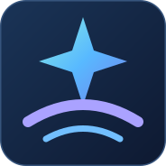

<p align="center">
  <a href="https://aurora.idlehandz.com/">
    
  </a>
</p>

# Aurora Lights

**5e+ Character Creation Suite**

Aurora Lights is an open-source, community-led family of D&D 5e character
builders developed and maintained by [Idle Handz](https://idlehandz.com).
This repository brings together **Aurora: Reflections**, **Aurora Legacy**, and
**Aurora Web**, with shared rules, content handling, and character compatibility.

**[Visit the official Aurora Lights website](https://aurora.idlehandz.com/)**

| Application | What it offers | Explore |
| --- | --- | --- |
| **Aurora: Reflections** | Modern character creation and a dedicated Session workspace. Release candidate for Windows x64 and Android ARM64. | [Overview & downloads](https://aurora.idlehandz.com/reflections/) · [User guides](https://aurora.idlehandz.com/reflections/documentation/) |
| **Aurora Legacy** | The familiar Windows desktop workflow, maintained on updated frameworks. | [Overview & guides](https://aurora.idlehandz.com/legacy/) |
| **Aurora Web** | A browser-based client in development. A public hosted service is not available yet. | [Development status](https://aurora.idlehandz.com/web/) |

> [!IMPORTANT]
> The current public candidate is **1.0.0-rc.5**, an unsigned Windows x64
> prerelease. Stable 1.0 is pending Windows code signing and validation of the
> final packages. Android ARM64 package acceptance has passed; the RC5 public
> release contains Windows downloads only. See the [current release status](docs/v1.0-release-status.md).
> Back up your characters before upgrading. Aurora Legacy is not required to
> build or run Aurora: Reflections.

## Project-Owned Source And Dependencies

Aurora Lights builds its first-party functionality from source maintained in
this repository. The former binary dependencies `Builder.Core`, `Builder.Data`,
`Aurora.Documents`, and `Aurora.Presentation` have project-local source
implementations, consumed through project references. No original Aurora
installation or prebuilt first-party legacy assembly is required for normal
application builds or runtime use.

The original assemblies under `tests/LegacyOracles` are retained only as
compatibility test fixtures. API and behavioral parity checks compare them with
the local implementations; they are not application dependencies. The project
still uses .NET, NuGet packages, and third-party libraries under `lib`.

See [source ownership and legacy compatibility](docs/LEGACY_RESTORATION.md) for
the source-project mapping, completed restoration status, and parity tooling.

## Install Aurora: Reflections

### Windows x64

1. Open the [Reflections download page](https://aurora.idlehandz.com/reflections/)
   for a suggested download, or browse the
   [GitHub releases](https://github.com/Idle-Handz/Aurora-Lights/releases).
2. Download the Windows `Setup.exe` asset for your system. Most Windows PCs use
   the `win-x64` release.
3. Run the installer and launch **Aurora: Reflections**.

`Setup.exe` installs the Microsoft Edge WebView2 Runtime if it is missing.
An internet connection is required for that download.

Windows installations created through `Setup.exe` use
[Velopack](https://velopack.io/) and can install future app updates from inside
Aurora: Reflections. Portable or extracted copies require WebView2 to already
be installed. They can check for new releases, but cannot apply updates in place.

RC5 is unsigned, so Windows may show an unknown-publisher or reputation warning.
Use the official release page and its checksums to verify the download. The
[Windows signing plan](docs/windows-code-signing.md) describes the SignPath
application and the work required before stable 1.0.

### Android ARM64

When a release includes an Android ARM64 `.apk`, download it from the official
release page and open it on the device. Android may ask you to allow installation
from the browser or file manager you used. The current public RC5 release does
not include an Android download.

To preserve existing app data, install an official update over the existing app.
Do not uninstall Aurora or clear its storage as an upgrade step. If Android
rejects an update, stop and report the error before changing the installation.

The v1.0 stable targets are Windows x64 and Android ARM64. Windows ARM64 and
Mac Catalyst remain experimental, and Web is deferred.

## What You Can Do

Aurora: Reflections currently supports the everyday character-building flow,
including:

- opening existing `.dnd5e` character files
- creating, leveling, and managing characters
- searching a SQLite-backed compendium
- managing equipment, spellcasting, and source content
- tracking session state such as hit points, spell slots, conditions, currency,
  resources, and notes
- previewing and exporting character sheets; Android offers Save PDF, Share PDF,
  and Open PDF with bundled fonts
- saving selected characters to Google Drive and opening them on Windows or
  Android
- checking for app and content updates

Drive saves are explicit: local draft recovery does not mean changes have been
uploaded. There is no background two-way sync or automatic merge of concurrent
edits. See [Google Drive cloud saves](docs/google-drive-cloud-saves.md) for
upload, recovery, account switching, and disconnect behavior.

The MAUI client is the active development target. Some unusual legacy files,
third-party content combinations, and advanced rules interactions may still
expose rough edges.

## Project Direction

Aurora Lights is not a single-client rewrite. It is an umbrella project for
keeping Aurora useful today while exploring ways to carry it forward.

- **Aurora: Reflections** (`Aurora.Reflections`) is the primary current focus: a modern
  MAUI client with a new interface and a gradual migration path for legacy
  Aurora users.
- **Aurora.Web** is an early step toward a fully online character builder. It
  currently explores browser-hosted Aurora workflows while sharing compatible
  logic and UI where practical.
- **Aurora Legacy** (`Aurora.Legacy`) is the legacy-facing desktop client. It
  aims to keep the familiar Aurora program alive and fully functional while
  moving it onto updated frameworks.

Contributors do not need to work on Reflections or the web client to make a
useful contribution. Small features, bug fixes, and troubleshooting work based
on the legacy application remain welcome, particularly when they improve the
shared compatibility layer for every client.

## Bring Existing Characters And Content

On Windows, Aurora: Reflections defaults to the same
`Documents\5e Character Builder` directory used by Aurora Legacy.
Existing `.dnd5e` character files and custom XML content should appear in place;
you do not need to import or convert them.

If your legacy Aurora installation uses a different storage root:

1. Open **Settings > General > Character Storage**.
2. Select the directory that contains your existing `.dnd5e` files and
   `custom` folder.
3. Open **Settings > Content > Data**.
4. Click **Sync Now**, then close any open character tabs and click
   **Reload Elements**.

Aurora: Reflections creates `custom\aurora-elements.sqlite` as a cache for its
modern content pipeline. Your XML files remain the source of truth, and the
SQLite cache can be rebuilt from them.

The bundled rules use the 2014-rules SRD 5.1 baseline. Existing characters may
need additional imported content that is no longer bundled. Keep the original
character file and resolve missing-content warnings before saving a replacement.
See the [public baseline migration guide](docs/v1-public-baseline-migration.md).

## Back Up And Recover Characters

Save your work and close character tabs before copying a backup. On Windows,
back up the entire character-storage directory, normally
`Documents\5e Character Builder`, including custom content and portraits. If you
copy individual characters, include their `.dnd5e.session.json` files when
present; these contain session state such as HP, spell slots, and resources.
Keep an independent copy of important characters and custom content from
Android as well. A PDF is a character sheet, not a restorable character backup.

For Drive characters, use **Save to Drive** and wait for confirmation before
switching devices. **Upload to Drive** on a character's Overview converts that
local character into a cloud-linked save after a successful upload; **Upload
external file** copies the selected file and keeps its original. Keep independent
character copies before making major changes. **Disconnect character** returns
the current cloud draft and session state to the local library without deleting
the Drive file. See the [Drive guide](docs/google-drive-cloud-saves.md) before
recovering or replacing a cloud save.

## Legacy Aurora Compatibility

Aurora: Reflections is designed to coexist with Aurora Legacy
and reuse the same character and content directory. This makes a gradual
migration possible, but the two applications do not merge concurrent edits.

When sharing characters between clients:

- back up the entire `5e Character Builder` directory before upgrading and
  before major content changes
- avoid editing the same character in both applications at the same time
- avoid running a legacy content update while Aurora: Reflections is syncing or
  reloading content
- close any open character tabs before reloading or rebuilding content
- use **Settings > Content** to review the active content directory and sync the
  SQLite database after content changes

The legacy WPF application remains in this repository as a parallel client.
Aurora: Reflections is intended to provide a gradual migration path rather than
an abrupt replacement.

## Known Limitations

- Windows ARM64 and Mac Catalyst are experimental. Web is deferred and has no
  public hosted service. Windows x64 and Android ARM64 are the stable 1.0 targets.
- Concurrent edits to the same character are not merged. The last application
  to save a `.dnd5e` file wins.
- Some unusual legacy character files, third-party content combinations, and
  advanced rules interactions may still expose compatibility gaps.
- After changing XML content, sync the SQLite database and reload elements
  before opening characters that depend on those changes.

## Report A Bug

Please use the [support page](https://aurora.idlehandz.com/support/) or the
[GitHub issue tracker](https://github.com/Idle-Handz/Aurora-Lights/issues) and
include:

- the Aurora: Reflections version
- the platform you were using
- a short set of reproduction steps
- a Console screenshot when an error is visible
- the affected `.dnd5e` character file when it is safe to share

Public issues and attachments are visible to everyone. Remove private character
notes and account information before posting. Never include passwords, access
tokens, or private diagnostic bundles. The app also links to the
[privacy policy](https://aurora.idlehandz.com/privacy/) and
[terms of service](https://aurora.idlehandz.com/terms/).

## Project Layout

- `Aurora.Reflections`
  MAUI Blazor Hybrid host for Aurora: Reflections. This is the primary modern
  desktop and mobile client.

- `Aurora.Components`
  Shared Razor components used across modern clients.

- `Aurora.Logic`
  Shared rules, models, content handling, and compatibility behavior.

- `Builder.Core`
  Project-owned foundation for events, logging, observable objects,
  and commands.

- `Builder.Data`
  Project-owned element models, XML parsing, rules, and content primitives.

- `Aurora.Documents`
  Project-owned PDF and character-sheet writing infrastructure.

- `Aurora.Presentation`
  Project-owned WPF controls, triggers, styles, and themes for Aurora Legacy.

- `Aurora.Importer`
  SQLite content importer used by the modern content pipeline.

- `Aurora.Web`
  Early browser-hosted Aurora experiment and first step toward a fully online
  builder.

- `Aurora.Legacy` (`Aurora.Legacy/Aurora.Legacy.csproj`)
  Legacy-facing WPF desktop client retained as a familiar, fully functional
  Aurora experience on updated frameworks. Its source lives in `Aurora.Legacy`.

## Development

The repository uses .NET 10. Useful project-level build commands:

```powershell
dotnet build .\Builder.Core\Builder.Core.csproj -v minimal
dotnet build .\Aurora.Logic\Aurora.Logic.csproj -v minimal
dotnet build .\Aurora.Reflections\Aurora.Reflections.csproj -v minimal -f net10.0-windows10.0.19041.0
dotnet build .\Aurora.Web\Aurora.Web.csproj -v minimal
dotnet build .\Aurora.Legacy\Aurora.Legacy.csproj -v minimal
```

On Windows, use the explicit Reflections framework shown above. A solution-wide
build also attempts the Android and Mac Catalyst targets and requires their
platform workloads.

Additional technical documentation:

- [Contributor guide](CONTRIBUTING.md)
- [Client feature comparison](docs/CLIENT_FEATURE_COMPARISON.md)
- [Current 1.0 release status](docs/v1.0-release-status.md)
- [Windows code signing](docs/windows-code-signing.md)
- [Aurora.Reflections README](Aurora.Reflections/README.md)
- [Aurora.Logic README](Aurora.Logic/README.md)
- [Source ownership and legacy compatibility](docs/LEGACY_RESTORATION.md)
- [Project roadmap](docs/ROADMAP.md)
- [Audit findings backlog](docs/BACKLOG.md)

## Support Aurora Lights

If Aurora Lights has been useful to you and you would like to support ongoing
development, consider supporting the project through Patreon or Ko-fi.

- [Patreon](https://patreon.com/IdleHandz)
- [Ko-fi](https://ko-fi.com/idlehandz)

Support helps fund Aurora Lights as well as other community, creator, and
technology projects developed under the Idle Handz banner.

## About Idle Handz

[Idle Handz](https://idlehandz.com) is a community-focused creator brand
dedicated to helping people discover hobbies, events, fandoms, and the
communities surrounding them.

## License

Aurora Lights original code is available under the [MIT License](LICENSE).
Bundled components and content retain their own terms. See the
[third-party inventory and notice maintenance guide](third-party/README.md).
Offline licenses and notices are available from **About → Licenses and notices**.

The public 1.0 preparation baseline uses SRD 5.1 game content. See the
[baseline migration guide](docs/v1-public-baseline-migration.md) for display-name
changes, imported-content compatibility and opening existing characters.
